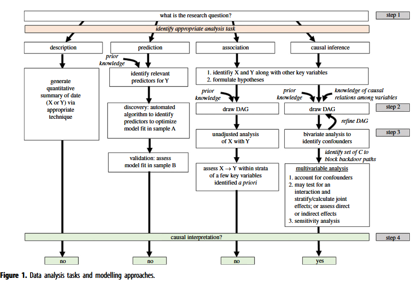
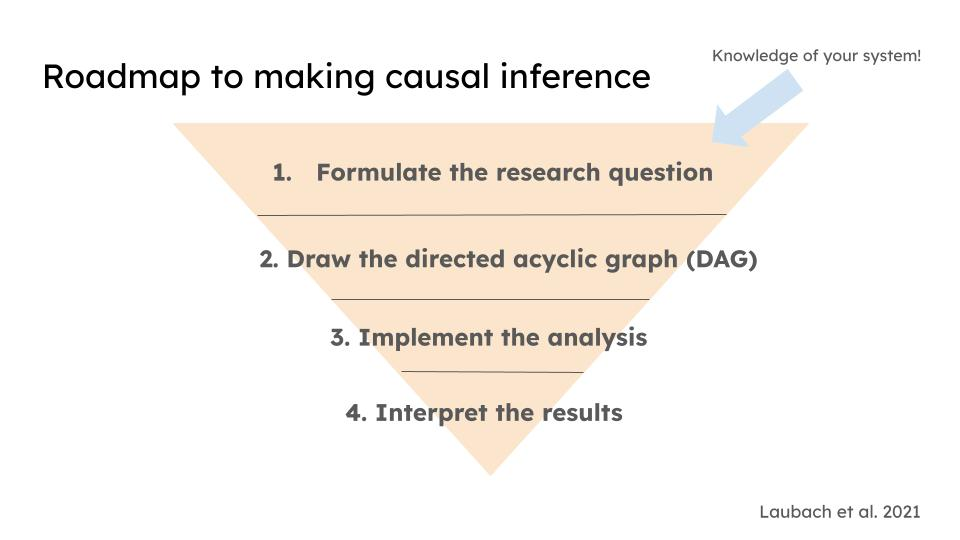
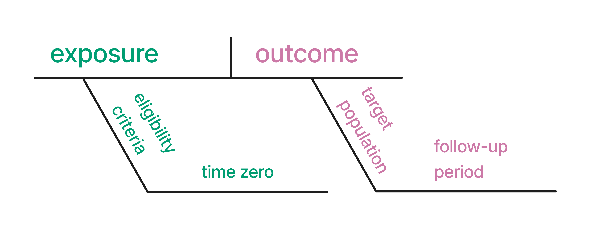
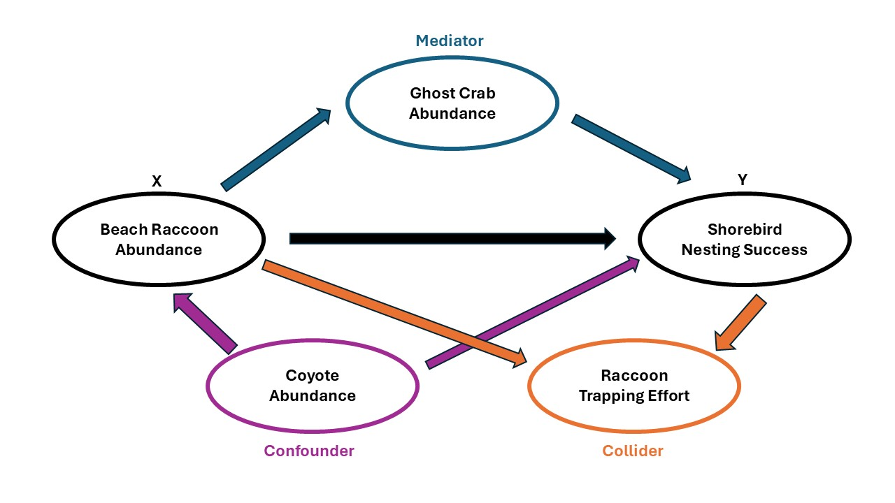
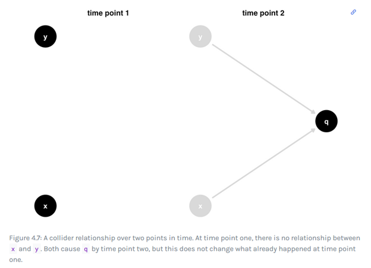
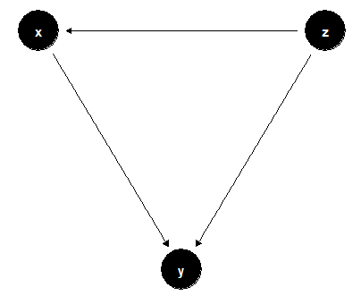
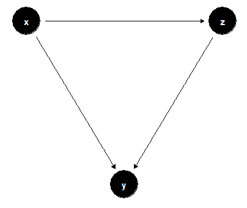
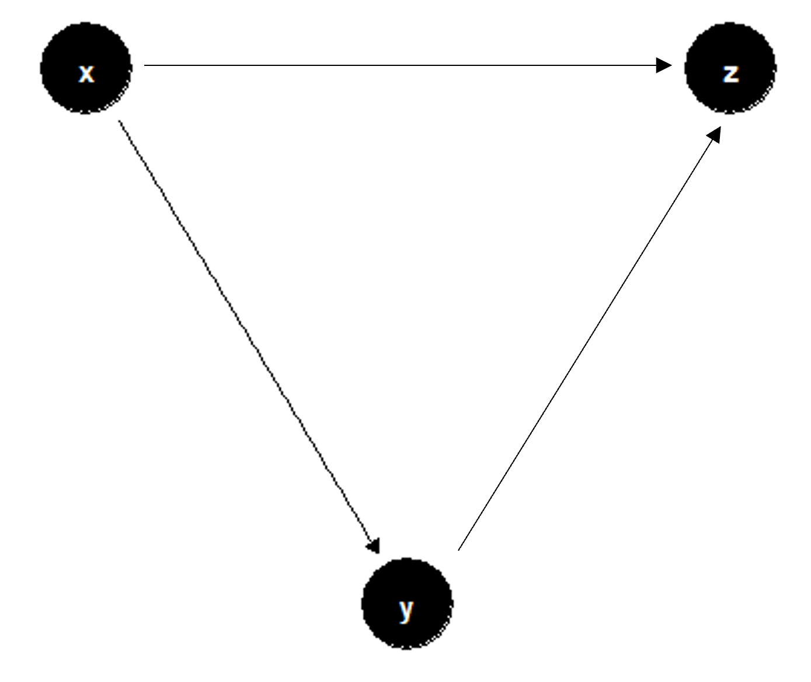

```{r setup-lab09, include=FALSE}
# Global setup chunk
knitr::opts_chunk$set(
  warning = FALSE,
  message = FALSE,
  fig.align = 'center',
  fig.retina = 2,
  collapse = TRUE,
  comment = "#>"
)

# Load all libraries
library(dplyr)
library(knitr)
library(FANR6750data)
library(ggplot2)
library(tidyr)
library(faux)

# Source Clark's palette
source(here::here("R/zzz.R"))
```


## Lab 10

- Interactions


## Today's topics

- Review of causal inference principles

  + Potential outcomes and counterfactuals

- Causal inference assumptions 

  + Exchangeability
  
  + Positivity
  
  + Consistency  
  
- Expressing causal questions as directed acyclic graphs (DAGs)
  
  + Confounders, mediators, and colliders

- Evaluating causal inference assumptions


<br>

# Causation

There are three main types of analytic framework in ecological work: **descriptive, predictive, and causal**.

- **Descriptive** analysis focuses on characterizing data (e.g., a species' diet breadth).
- **Predictive** analysis centers around forecasing and is focused on the outcome variable only(e.g., comparing models via AIC).
- **Causal** inference is about being able to predict the change in an outcome following a change in a potential causal variable (e.g., X causes/effects/affects Y).

```{r, echo=FALSE, out.width="100%", fig.align="center", fig.cap="*Types of data analysis tasks from Laubach et al. 2021*"}

```

<br>
As ecologists, we are often interested in **causation**: whether a change in one variable (X; the cause) produces a change in another variable (Y; the effect). Although the field of causal inference is well-developed and widely used in some fields (e.g., economics, public health), the application of these methods in ecological studies remains relatively rare because ecological systems are inherently complicated and difficult to distill to a simple "X causes Y" relationship. However, understanding the extent to which a change in one variable produces a change in another variable is vital for understanding how to manage factors that might be causing population declines for imperiled species (e.g., threatened shorebirds) or population increases of invasive species (e.g., feral hogs). 

Each analysis task, whether descriptive, predictive, or causal, should start with a clear, precise question *before* data collection begins. For good causal inference questions, the researcher needs to a priori determine the cause, the effect, the subject (for whom?), and the timing (when?). 

<br>

```{r, echo=FALSE, out.width="70%", fig.align="center", fig.cap="*Roadmap to causal inference based off of Laubach et al. 2021.*"}

```

<br>

```{r, echo=FALSE, out.width="70%", fig.align="center", fig.cap="*Example of diagraming a causal claim.*"}

```

<br>

Let's start with a basic causal question: 

**Does the abundance of raccoons on the beach cause the number of American Oystercatcher (a shorebird) young that fledge on the beach?**

This version of the question leaves out the eligibility criteria, time zero, target population, and follow-up period needed for a rigorous causal analysis. Asking a *good* causal question means mapping the question onto observable evidence. A better-scoped version might be:

> "On beaches with high raccoon activity, does reducing raccoon presence by 50% increase shorebird nest survival to hatching within a single breeding season (2023)?"

Honing this skill--asking answerable causal questions--is essential for proper causal inference.

```{r, echo=FALSE, out.width="60%", fig.align="center", fig.cap="*American Oystercatcher adult. Photo by Neal Graff.*"}
knitr::include_graphics("fig/amoy.jpg")
```

## Potential Outcomes and Counterfactuals

Conceptually, causation is often defined in terms of **potential outcomes**, defined as the difference in the outcome Y between two states: one where the cause X is modified (e.g., X = 1) and one where it is not (e.g., X = 0). It is important to note that potential outcomes are defined in terms of a *single* observational unit that simultaneously experiences different levels of X. Under this hypothetical scenario, all factors influencing Y other than X are constant, and thus the difference between the two responses is the causal effect of X. 

The foundational challenge of causal inference is that we can only ever observe **one** state of the world at a time. We cannot directly observe the **counterfactual**, the alternative scenario in which that same unit experienced a different level of X. 

For example, suppose we want to know whether removing raccoons from a beach influences American Oystercatcher nesting success in summer 2023. The exposure has two levels:

  + *X = remove raccoons* - all beach raccoons removed in 2023
  
  + *X = keep raccoons* - no beach raccoons removed in 2023
  

Under this scenario, there are two potential outcomes:

  + *Y(remove raccoons)* - the potential outcome if *X = remove raccoons* 
  
  + *Y(keep raccoons)* - the potential outcome if *X = keep raccoons*

Only **one** of these potential outcomes will be realized, the factual one corresponding to the exposure that actually occurred in 2023. For if we remove all raccoons on the beach, we cannot simultaneously observe how shorebird nesting would have responded to the **counterfactual** scenario of keeping all raccoons on the beach. Counterfactuals are central to the design of manipulative experiments but can be difficult (if not impossible) in some study systems. 

**Trying to construct a counterfactual serves as the basis of good experimental design.**

<br>

# Causal Inference Assumptions and DAGs

In practice, causal inference relies on comparing the average response of groups assumed to be equivalent in all regards *except* for the cause X, an assumption known as **exchangeability**. In practice, obtaining exchangeable groups is difficult because observational units (Ys) often differ in many ways other than the cause X.

Take the raccoon–shorebird example. Raccoons aren't the only thing affecting nest survival: proximity to the high-tide line (nest overwash), other predators (feral hogs, coyotes, grackles), parental attentiveness, human disturbance, and unleashed dogs all matter too. These other sources of variation create **confounding**: when left unaddressed, confounding prevents us from concluding that X (raccoon presence) actually causes Y (nesting success), rather than just being correlated with it.

**Confounding is the reason behind the adage "correlation is not causation."** A correlation between X and Y often just reflects one or more confounding variables driving both.

- **In manipulative experiments**, confounding is addressed through *randomization*. Randomly assigning levels of X (e.g., remove vs. keep raccoons) to units (beaches) breaks the link between X and any confounders, making treatment groups exchangeable. This is what makes manipulative experiments the gold standard for causal inference.

- **In observational studies**, we can't randomize, so X is often confounded with other variables (predation type, human disturbance, tide-line proximity, etc.). **Because confounders can't be removed by randomization, they must be accounted for statistically.** Most methods for inferring causal relationships from observational data — regardless of the specific technique — require identifying relevant confounders up front. The most common framework for doing this is **Structural Causal Modeling (SCM)**, which uses graphical models called **directed acyclic graphs (DAGs)** to represent hypothesized causal relationships among variables.

<br>

## DAGs

Using prior knowledge, theory, and existing literature, researchers build DAGs to make explicit which variables are confounders. From a DAG, you can identify a **sufficient adjustment set** — the set of variables that, when statistically controlled for, make treatment groups exchangeable with respect to confounding and allow valid causal estimation from observational data.

DAGs also help identify two other important variable types:

- **Mediators** — variables on the causal pathway *between* X and Y (should generally not be conditioned on).
- **Colliders** — common *effects* of both X and Y (should never be conditioned on).

The table below summarizes all four variable types you need to be able to recognize, using the raccoon–shorebird system as a running example.

| Variable type | Definition | Adjust for it? | Example in raccoon–shorebird system |
|---|---|---|---|
| **Confounder** | A common *cause* of both X and Y | **Yes** — required to close the backdoor path | Coyote abundance (affects both raccoon abundance and nesting success) |
| **Mediator** | On the causal pathway *from* X *to* Y | Depends — only if you want the *direct* effect, not the *total* effect | Ghost crab abundance (raccoons eat crabs; crabs eat shorebird eggs) |
| **Collider** | A common *effect* of both X and Y | **No** — conditioning on it introduces bias | Raccoon trapping effort (driven by both raccoon abundance and nest success) |
| **Competing exposure** | Affects Y but not X | Optional — including it can improve precision | High-tide height (overwashes nests, doesn't affect raccoon presence) |


```{r, echo=FALSE, out.width="100%", fig.align="center", fig.cap="*DAG of causal relationship between beach raccoon abundance and shorebird nesting success.*"}

```

<br>

You can build DAGs in R with the `ggdag` package, which connects `ggplot2` to `dagitty`, an R package with algorithms for querying DAGs.

The `dagify()` function builds a `dagitty` object that works with both `dagitty` and `ggdag`. It takes formulas separated by commas, where the left-hand side is the *effect* and the right-hand side lists its *causes* — the same syntax you'd use to specify a regression formula in R. The code below encodes the raccoon–shorebird example as a `dagify()` object:

```{r, eval= T, include= T}
#install.packages("ggdag")
library(ggdag)

beach_dag <- dagify(
  raccoon ~ coyote,
  crab ~ raccoon,
  trap ~ raccoon + shorebird,
  shorebird ~ coyote + raccoon + crab,
  coords = time_ordered_coords(
    list(
      # time point 1
      "raccoon",
      # time point 2
      c("coyote", "crab", "trap"),
      # time point 3
      "shorebird"
    )
  ),
  exposure = "raccoon",
  outcome = "shorebird",
  labels = c(
    raccoon = "raccoon abun",
    shorebird = "bird nesting",
    coyote = "coyote abun",
    crab = "crab abun",
    trap = "trap effort"
  )
)
ggdag(beach_dag, text = FALSE) +
  geom_dag_label_repel(aes(label = label), 
                        box.padding = 2,
                        segment.color = "grey50",
                        show.legend = FALSE) +
  theme_dag()
```

<br>

## Causal Assumptions

Beyond **exchangeability**, estimating causal effects from observational data under the SCM framework requires three more assumptions. In total, there are **4 assumptions required for valid causal inference**:

1. **Exchangeability** — treatment groups are comparable in all respects except X.
2. **Positivity** — every unit has a non-zero chance of experiencing each level of X.
3. **Consistency** — the observed outcome under a given exposure equals the true potential outcome for that exposure.
4. **A correctly specified DAG** — the causal structure you've drawn actually reflects reality.

**Positivity.** Every experimental unit must have a non-zero probability of receiving each level of X. For example, every shorebird-nesting beach should have some chance of hosting anywhere from zero to many raccoons. Positivity can be violated for structural reasons (some units *can't* experience certain levels of X) or stochastic reasons (small sample sizes mean some levels of X just weren't observed). If raccoon predators are structurally absent from non-urbanized beaches, for instance, we can't estimate the effect of raccoon predation there.

**Consistency.** Sometimes called the *stable-unit-treatment-value assumption* (SUTVA). It requires that the observed response Y under a given level of X equals the true potential outcome for that level of X. This is violated when X is poorly defined, or when one unit's outcome depends on another unit's exposure (*interference*). For example, if supplemental feeding on urban beaches draws raccoons away from — or toward — neighboring beaches, the exposure at one beach is no longer independent of what's happening at others.

**Correctly specified DAG.** All causal inferences are conditional on getting the DAG right. Omitting an important confounder, or misrepresenting a causal relationship, can bias estimates even when exchangeability, positivity, and consistency all hold.

Two important caveats:

1. These four assumptions are **separate from, and in addition to**, the usual statistical assumptions of whatever model you use (regression, difference-in-differences, instrumental variables, etc.). Both sets of assumptions must hold for valid results.

2. **There is no statistical test that can confirm these causal assumptions.** You cannot check them the way you'd check normality or homoscedasticity. Instead, researchers rely on domain knowledge to judge whether the assumptions are plausible (sensitivity analyses can help assess how robust conclusions are to violations). This makes careful reasoning and transparent reporting essential parts of causal inference — even though "meeting" these assumptions perfectly is rarely possible in complex ecological systems.

<br>

## What variables to include in a statistical model

Understanding your study system well is one of the most important prerequisites for building a *correctly specified DAG*. A DAG is a hypothesis about the causal structure linking X (the cause) and Y (the effect) — one that should be scrutinized and revised as needed. The goal isn't a perfect DAG, but a *useful* one that makes your causal assumptions explicit and supports rigorous effect estimation.

Throwing every available covariate into a model (so-called **"causal salad"**) often makes things *worse*, not better. The purpose of drawing a DAG is to reason through which covariates you can measure, and whether each one actually needs to be in your adjustment set.

A DAG only tells you about the effect of X on Y. If a covariate Z is in the model, the DAG doesn't tell you anything about the effect of Z on Y — Z is just part of the adjustment set (or something to avoid adjusting for).

Here we revisit the three variable types from the table above, in more depth:

- **Confounders** are a common cause of both X and Y. In the raccoon–shorebird example, coyote abundance confounds the raccoon–shorebird relationship. Failing to control for it opens a **backdoor path** — a non-causal pathway that creates a spurious association between raccoon abundance and nesting success. Including the confounder in the model closes this path.

- **Mediators** relay causality from X to Y. Ghost crab abundance mediates the raccoon–shorebird relationship. Including mediators in your adjustment set blocks part of the causal pathway you're trying to measure. Adjusting for *all* mediators isolates the **direct effect** (X's effect on Y along the direct arrow only). Leaving mediators out captures the **total effect** (X's effect through *all* pathways, direct and indirect). Researchers usually want the total effect — but not always, so this decision should be deliberate.

- **Colliders** are a common *effect* of both X and Y. Because causality only flows forward in time, a collider — which occurs *after* both X and Y — cannot influence either of them. Conditioning on a collider opens a biasing pathway between X and Y that didn't exist before, because it introduces statistical information linking two variables that were otherwise independent. In the raccoon example, raccoon trapping effort is a collider: it's driven by *both* raccoon abundance and nest success, since managers only invest heavily in trapping when raccoon numbers are high or nest success is poor. Including a collider in a causal model can introduce selection bias severe enough to reverse the sign of your estimated effect.
  
```{r, echo=FALSE, out.width="70%", fig.align="center", fig.cap="*Collider relationship over two points in time from the Causal Inference in R textbook [https://www.r-causal.org/chapters/04-dags].*"}

```

- **Competing exposures** affect Y but not X. High-tide height is a good example. High tides overwash nests which prevents shorebird eggs from hatching, but overwash doesn't affect raccoon presence on the beach. Including a competing exposure isn't required for unbiased estimation, but it can improve the *precision* of your estimate.

To learn more about causal inference, see [Chapters 3 and 4 in the Causal Inference in R textbook](https://www.r-causal.org/chapters/04-dags),["Foundations and Future Directions for Causal Inference in Ecological Research" by Siegel and Dee in 2025](https://onlinelibrary.wiley.com/doi/10.1111/ele.70053), and ["Ecology needs a causal overhaul" by Franks et al. 2025](https://onlinelibrary.wiley.com/doi/full/10.1111/brv.70029).

<br>
<br>

# Worked examples from lecture

Let's explore the examples from class, using some of the tools from this lab to extend our discussion of those data sets.

**1.** A group of researchers is interested in how body mass influences "boldness" in fictitious Fruitcake Lizards. The researchers searched their study area and captured lizards that they encountered (n=150). They then used a well-established observational method to quantify the "boldness" of each individual. They also recorded the age of each lizard, the lizard's escape speed as it was released, and the habitat openness of the area where it was caught. You obtain the `lizard` dataset below:
  
```{r}
data(boldnessdata)
head(boldnessdata)
```

  a. What is the main causal question that these researchers are trying to answer? In your response, please state what variable is the exposure (X) and the outcome (Y). For all other variables recorded in the dataset, please identify whether each variable is likely a confounder, collider, mediator, or competing exposure, and justify your responses. 
  
  b. Create a DAG using `daggify()` to visualize the relationship between the exposure, outcome, and all other variables recorded in the dataset.
  
  c. The researchers are interested in the *total causal effect* of the exposure on the outcome. Given your knowledge of which variables in the dataset are confounders, colliders, mediators, or competing exposures, formulate the linear model in `R` and interpret the results of the model. What is the relationship between your exposure (X) and the outcome (Y)? Create a plot and interpret your results in the context of the biological system.
  
  d. Using a linear model, the researchers found a strong negative association between X and Y (beta = -0.57, SE = 0.06, t =  -10.49, p < 0.001). Previous studies of *captive-reared* Fruitcake Lizards found no relationship between the exposure (X) and the outcome (Y). Why do you think that these results differ between wild and captive-reared lizards?
  
  e. Using your linear model from part (c), assess whether your observational data meets the 4 causal inference assumptions. 

<br>  

**2.** A grad student is studying efforts to recover populations of the made-up, endangered Heirloom Trillium. The student is sent a dataset containing 20 years of surveys from a nature preserve containing a large population of the species. The data includes the number of Trillium plants found at the beginning of the spring, the number of plants at the end of summer, an index of acorn mast the previous fall, and the estimated number of deer within the study area. You obtain the `trillium` dataset below:
  
```{r}
data(trilliumdata)
head(trilliumdata)
```
 
  a. The student wants to test whether there is an association between: (1) mast and final abundance and (2) mast and initial abundance. Run 2 linear models in `R` using just those Xs and Ys, interpret the results of the models, and create a plot for each model.
  
  b. The student wants to add deer abundance to the model where X = mast and Y = initial Trillium abundance. Run this linear model in `R` and interpret the results of the model. How does the effect of mast change when deer are added to the model? Why might this occur (hint: create a DAG)?

  c. Is it reasonable to conclude that acorn mast has a causal effect on Trillium abundance?
  
  d. Does anything in either model output tell you which model is correct?
  
  e. If you were starting this project *before* data collection began, how would you approach this project differently from a causal inference standpoint?
  
<br>

# Assignment:

**Create an R Markdown file, and let's work through examples that use these causal inference principles and assumptions in practice:**

**A few things to remember when creating the document:**

- Set the output type to `output: html_document`.
- Set `echo = TRUE` in all `R` chunks so that all code and output is visible in the knitted document.
- Knit the document regularly as you work to catch errors early.

---

Say that you are a forest manager interested in how the *imaginary* cerulean cambium-chewer beetle influences the population abundance of the *imaginary* threatened cerulean cambium tree (based on a real research project with credit to Hanusia Higgins) in Cerulean National Forest. As a forest manager, you are especially interested in whether higher beetle abundances cause more trees to die. It often takes around 1 year for these beetles to grow to the mature size where they can viciously chew through the cambium of the tree, ultimately killing the threatened tree within a week. As the person in charge of learning more about the causal relationship between the population abundances of these beetles and the death of these trees, you are tasked with designing a study to learn more about if the beetles are actually causing the trees to die. 

The question that you are looking to answer is: 

**Does beetle abundance of last year (2025) predict whether beetles will kill more trees this year (2026)?** 

You are given the following data from your supervisor:

  + Number of beetles caught in traps in 2025

  + Number of trees killed by beetles in 2026

  + Number of felled trees documented in the area in 2025


**1.** Given this data and your question, what data from your manager would represent X (the predictor), Y (the outcome), and Z (a variable influencing the relationship between X and Y)?


**2.** You want to visualize your data to better understand the relationships among your 3 variables using the raw data below.

```{r}
xyz <- read.csv("fig/xyz_data.csv")
head(xyz)
```

  a. Please plot 3 graphs that visualize the relationships between X & Y, X & Z, and Y & Z with appropriate graph labels. Please explain the relationships of the variables in each graph using summary statistics. 
  
  b. What is the term for this *relationship* among the 3 variables (hint: think back to the "Lab 8: Assumptions of Linear Models")?
  
  c. What is 3 possible causal explanations (1 for each graph above) based on your knowledge of this beetle-tree system that might explain the *relationship* described above in part b?
  
  d. Given this relationship, do either X or Z need to be removed from the statistical model? Please explain your reasoning.
  
  
**3.** If this is your DAG:

```{r, echo=FALSE, out.width="40%", fig.align="center"}

```

  a. Is Z a mediator, confounder, or collider? Please explain your reasoning within the context of the ecological system.
  
  b. Which variables should be included in the statistical model? Please explain your reasoning, run the model, and interpret the results of your linear model.
  

**4.** If this is your DAG:

```{r, echo=FALSE, out.width="40%", fig.align="center"}

```

  a. Is Z a mediator, confounder, or collider? Please explain your reasoning within the context of the ecological system.
  
  b. Which variables should be included in the statistical model? Please explain your reasoning, run the model, and interpret the results of your linear model.
  

**5.** If this is your DAG:

```{r, echo=FALSE, out.width="40%", fig.align="center"}

```

  a. Is Z a mediator, confounder, or collider? Please explain your reasoning within the context of the ecological system.
  
  b. Which variables should be included in the statistical model? Please explain your reasoning, run the model, and interpret the results of your linear model.
  
**6.** At the end of your document, under a header titled "Reflection", answer the following questions: 

- On a 1-10 scale, how would you rate your confidence in the topics covered in this lab? 

- What lingering questions/confusion about these topics do you still have?

A few things to remember when creating the document:

- Be sure to include your name in the `author` field of the header

- Be sure the output type is set to: `output: html_document`

- Be sure to set `echo = TRUE` in all `R` chunks so that all code and output is visible in the knitted document

- Regularly knit the document as you work to check for errors

- See the R Markdown reference sheet for help with creating `R` chunks, equations, tables, etc.

- If you use AI on any part of your assignment, you must include the full prompt(s) you used and it's full answer(s) in a **separate section** titled "AI assistance" at the end of this document.
