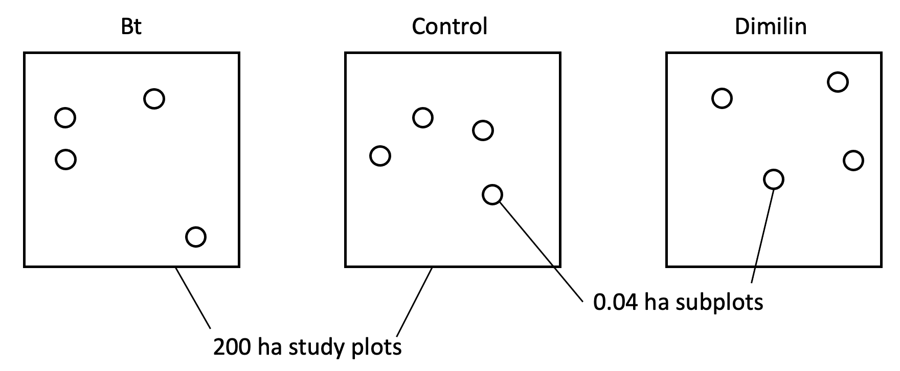

---
format:
  revealjs:
    highlight-style: github
    incremental: false
    theme: FANR6750.scss
    reference-location: document
knitr:
  opts_chunk:
    dev: png
    dev.args: { bg: "transparent" }
from: markdown+emoji
---

```{r setup}
#| echo: false
#| include: false
options(htmltools.dir.version = FALSE)
knitr::opts_chunk$set(echo = FALSE, fig.align = 'center', warning = FALSE,
                      message = FALSE, fig.retina = 2)
source(here::here("R/zzz.R"))
library(FANR6750data)
library(dplyr)
library(kableExtra)
library(ggdag)
```

## LECTURE 17: psuedoreplication part 1: nested designs {.theme-title .center}

::: footer
FANR 6750\
Fall 2026
:::

## Outline {.theme-inverse .smaller}


#### 1) Motivation

<br/>  

:::{.fragment}

#### 2) Model

<br/> 

:::

:::{.fragment}

#### 3) Procedure

<br/> 

:::

:::{.fragment}

#### 4) Example

<br/> 

:::

## Motivation {.smaller}

Often, the response variable is measured numerous times within the experimental unit  

:::{.fragment}

For example, we might apply a pesticide for gypsy moth control to 200 ha plots. We want to see if there are fewer gypsy moths on treated plots compared with untreated plots, but we can't sample the whole plot, so we work with four subplots of 0.04 ha each. The 3 plots below represent one replicate of each of the treatments  

```{r out.height="80%", out.width="80%"}

```

:::

## Terminology {.smaller}

There are numerous terms for subplots. Sometimes they are called subsamples. In experimental design terminology, we refer to the 0.04-ha subplots as **subunits**, and the 200-ha plots as
**whole units**, and the design in general is referred to as a **nested design**

```{r out.height="80%", out.width="80%"}

```


## Other examples of nested designs

<br/>

```{r}
nested <- data.frame(resp= c("Fish Abundance", "Lead (Pb) levels", "Tree height"),
                      whole = c("River", "Individual", "Stand"),
                      subunit= c("Reach", "Blood sample", "Quadrat"),
                      scope = c("All rivers in study area", "Population", "All stands in study region"))

nested %>%
  kable(format = "html", 
        col.names = c("Response", "Whole unit", "Subunit", "Scope of inference")) %>%
  kable_styling(font_size = 20)
  
```


## Model (anova version) {.theme-inverse .center}

## Data structure for nested design {.smaller}

$$\Large y_{ijk}$$

- $i$ = treatment level

- $j$ = whole unit

- $k$ = subunit

```{r}
n <- data.frame(expUnit = rep(c("1", "2"), each = 3),
                obs = rep(c("1", "2", "3"), 2),
                bt = c('\\(y_{111}\\)', '\\(y_{112}\\)', '\\(y_{113}\\)', 
                       '\\(y_{121}\\)', '\\(y_{122}\\)', '\\(y_{123}\\)'),
                contr = c('\\(y_{211}\\)', '\\(y_{212}\\)', '\\(y_{213}\\)', 
                       '\\(y_{221}\\)', '\\(y_{222}\\)', '\\(y_{223}\\)'),
                dim = c('\\(y_{311}\\)', '\\(y_{312}\\)', '\\(y_{313}\\)', 
                       '\\(y_{321}\\)', '\\(y_{322}\\)', '\\(y_{323}\\)'))

n %>%
  kable(format = "html", align = "c", col.names = c(" ", " ", "Bt", "Dimilin", "Control"), 
        escape = TRUE) %>%
  add_header_above(c("Experimental unit (j)" = 1, "Subunit (k)" = 1,  
                     "Treatment (i)" = 3)) %>%
  kable_styling(bootstrap_options = c("condensed"), font_size = 16)
```


## Model (anova version) {.smaller}

$$y_{ijk} = \mu + \alpha_i + \beta_{ij} + \epsilon_{ijk}$$

$$\beta_{ij} \sim normal(0, \sigma^2_\beta)$$

$$\epsilon_{ijk} \sim normal(0, \sigma^2)$$

:::{.fragment}

$$i = 1, ..., a \;(treatment \;levels)$$
$$j = 1, ..., b \;(whole \; units)$$
$$k = 1, ..., n \;(subunits)$$
:::

:::{.incremental}
- $\mu =$ grand mean  

- $\alpha_i =$ effect of the $i$th treatment  

- $\beta_{ij} =$ **random** effect of the $ij$th whole unit  

- $\epsilon_{ijk} =$ residual, unexplained variation
:::


## Hypotheses {.smaller}

Main hypothesis of interest

$$H_0 : \alpha_1 = \alpha_2 = ... = \alpha_a = 0$$

$$H_a : At \;least \;one \;inequality$$

Secondary hypothesis

$$H_0 : \sigma^2_\beta = 0$$

$$H_a : \sigma^2_\beta > 0$$

## Procedure (anova version) {.theme-inverse .center}


## Anova table {.smaller}

<br/>

```{r anova_tab}
anova_tab <- data.frame(Source = c("Among treatment", "Among whole units", "Among subunits (i.e., residual)"),
                        Symbol = c('\\(SS_a\\)', '\\(SS_b\\)', '\\(SS_e\\)'),
                        df = c('\\(a-1\\)', '\\(a(b-1)\\)', '\\(ab(n-1)\\)'),
                        SS = c('\\(bn \\sum_i (\\bar{y}_{i} - \\bar{y}.)^2\\)', 
                               '\\(n \\sum_i \\sum_j (\\bar{y}_{ij} - \\bar{y}_{i})^2\\)',
                               '\\(\\sum_i \\sum_j \\sum_k (y_{ijk} - \\bar{y}_{ij})^2\\)'))

anova_tab %>%
  kable(align = 'c', booktabs = TRUE, escape = FALSE, format = "html") %>%
  kable_styling(bootstrap_options = c("condensed"), 
                full_width = FALSE, font_size = 18) 
```

:::{.fragment}

What are the associated mean squares and F statistics?

:::{.incremental}
- Mean squares are calculated as before ($SS/df$)

- Based on our previous lecture on ANOVA tables, you might think $F = \frac{MS_a}{MS_e}$

    + This tests whether the variation among treatment groups is larger than the residual variation across all subunits

- That test assumes that we have $ab(n-1)$ observations of our treatment effect^[the df for $MS_e$]

- But that is not quite true...why?
:::
:::


## Pseudoreplication {.theme-inverse .center}

## Pseudoreplication {.smaller}


Pseudoreplication is a general term for treating observational units as independent measures of the a treatment effect, when they are really not

- Originally described in an [influential paper](https://esajournals.onlinelibrary.wiley.com/doi/abs/10.2307/1942661) by Stuart Hurlbert 

:::{.incremental}
- In nested designs, subunits are not independent measures of the treatment effect. How many replicates of each pesticide treatment do we have in this example? 

- In an extreme case, we might not even replicate the treatments. In that case, subunits do not help us. The experiment is still unreplicated!

- Psuedoreplication occurs when subunits are treated as the experimental unit in an F-test, resulting in the incorrect error degrees of freedom
:::


## Anova table {.smaller}

<br/>

For nested designs, the correct ANOVA table is:

```{r anova_tab2}
anova_tab2 <- data.frame(Source = c("Among treatment", "Among whole units within treatments", "Among subunits within whole units"),
                        MS = c('\\(\\frac{SS_a}{a-1}\\)', '\\(\\frac{SS_b}{a(b-1)}\\)',
                               '\\(\\frac{SS_e}{ab(n-1)}\\)'),
                        F = c('\\(\\frac{MS_a}{MS_b}\\)', 
                               '\\(\\frac{MS_b}{MS_e}\\)', NA))

options(knitr.kable.NA = " ")
anova_tab2 %>%
  kable(align = 'c', booktabs = TRUE, escape = FALSE, format = "html") %>%
  kable_styling(bootstrap_options = c("condensed"), 
                full_width = FALSE, font_size = 18) 
```


## Example {.smaller}

::::{.columns}

:::{.column width=50%}
```{r}
exp <- data.frame(obs = rep(c(1, 2, 3, 4), 3),
                  expUnit = rep(c(1,2,3), each = 4),
                  bt = c(16.0, 16.0, 15.8, 14.2, 13.9, 14.2, 13.5, 13.4, 14.0, 13.1, 13.5, 15.4),
                  Dim = c(12.3, 13.0, 12.7, 12.0, 14.0, 13.1, 13.5, 13.4, 13.0, 12.4, 12.8, 13.8),
                  cnl = c(18.5, 18.0, 18.4, 18.1, 18.7, 19.0, 18.8, 18.5, 19.5, 17.5, 19.1, 20.9))

exp %>%   
  kable(format = "html", align = "c", col.names = c(" ", " ", "Bt", "Dimilin", "Control"), 
        escape = TRUE) %>%
  add_header_above(c("Subunit (k)" = 1, "Experimental unit (j)" = 1, 
                     "Treatment (i)" = 3)) %>%
  kable_styling(bootstrap_options = c("condensed"), font_size = 14)
```
:::


:::{.column width=50%}
```{r}

data("mothdata2")
mothdata2$Treatment <- factor(mothdata2$Treatment, 
                              levels = c("Control", "Bt", "Dimilin"))

mothdata2$Plot <- factor(mothdata2$Plot)
plotData <- aggregate(larvae ~ Treatment + Plot, 
                      data = mothdata2, FUN = mean)
plotData <- aggregate(larvae ~ Treatment + Plot, 
                      data = mothdata2, FUN = mean)
plotData$treatment = c( 1.75, 2, 2.25, 0.75, 1, 1.25, 2.75, 3, 3.25)

y.bar <- dplyr::group_by(mothdata2, Treatment) %>% summarise(mu = mean(larvae)) %>%
  dplyr::mutate(treatment = c(1, 2, 3))
y.bar$exp <- mean(mothdata2$larvae)
mothdata2$treatment <- rep(c( 1.75, 2, 2.25, 0.75, 1, 1.25, 2.75, 3, 3.25), each = 4) + rnorm(36, 0, 0.05)
mothdata2$exp <- rep(plotData$larvae, each = 4)
plotData$exp <- rep(c(14.42, 18.75, 13), each = 3)
```

:::
::::

## Example {.smaller}

::::{.columns}
:::{.column width=50%}
```{r}
exp <- data.frame(obs = rep(c(1, 2, 3, 4), 3),
                  expUnit = rep(c(1,2,3), each = 4),
                  bt = c(16.0, 16.0, 15.8, 14.2, 13.9, 14.2, 13.5, 13.4, 14.0, 13.1, 13.5, 15.4),
                  Dim = c(12.3, 13.0, 12.7, 12.0, 14.0, 13.1, 13.5, 13.4, 13.0, 12.4, 12.8, 13.8),
                  cnl = c(18.5, 18.0, 18.4, 18.1, 18.7, 19.0, 18.8, 18.5, 19.5, 17.5, 19.1, 20.9))

exp %>%   
  kable(format = "html", align = "c", col.names = c(" ", " ", "Bt", "Dimilin", "Control"), 
        escape = TRUE) %>%
  add_header_above(c("Subunit (k)" = 1, "Experimental unit (j)" = 1, 
                     "Treatment (i)" = 3)) %>%
  kable_styling(bootstrap_options = c("condensed"), font_size = 14)
```
:::


:::{.column width=50%}
$$\large y_{ijk} = \mu$$

```{r}
ggplot() +
  geom_hline(yintercept = mean(mothdata2$larvae)) +
  # geom_segment(data = y.bar, 
  #              aes(x = treatment-0.5, xend = treatment+0.5, y = mu, yend = mu, color = Treatment),
  #              linewidth = 1) +
  # geom_segment(data = plotData, aes(x = treatment-0.1, xend = treatment + 0.1, y = larvae, 
  #                                   yend = larvae, color = Treatment)) +
  geom_blank(data = mothdata2, aes(x = treatment, y = larvae, color = Treatment), size = 1) +
  scale_y_continuous("Larvae") +
  scale_x_continuous("Treatment", breaks = c(1, 2,3), labels = c("Control", "Bt", "Dimilin"))
```

:::
::::

## Example {.smaller}

::::{.columns}
:::{.column width=50%}
```{r}
exp <- data.frame(obs = rep(c(1, 2, 3, 4), 3),
                  expUnit = rep(c(1,2,3), each = 4),
                  bt = c(16.0, 16.0, 15.8, 14.2, 13.9, 14.2, 13.5, 13.4, 14.0, 13.1, 13.5, 15.4),
                  Dim = c(12.3, 13.0, 12.7, 12.0, 14.0, 13.1, 13.5, 13.4, 13.0, 12.4, 12.8, 13.8),
                  cnl = c(18.5, 18.0, 18.4, 18.1, 18.7, 19.0, 18.8, 18.5, 19.5, 17.5, 19.1, 20.9))

exp %>%   
  kable(format = "html", align = "c", col.names = c(" ", " ", "Bt", "Dimilin", "Control"), 
        escape = TRUE) %>%
  add_header_above(c("Subunit (k)" = 1, "Experimental unit (j)" = 1, 
                     "Treatment (i)" = 3)) %>%
  kable_styling(bootstrap_options = c("condensed"), font_size = 14)
```
:::


:::{.column width=50%}
$$\large y_{ijk} = \mu + \alpha_i$$
```{r}
ggplot() +
  geom_hline(yintercept = mean(mothdata2$larvae)) +
  geom_segment(data = y.bar, aes(x = treatment, xend = treatment, y = exp, yend = mu)) +
  geom_segment(data = y.bar,
               aes(x = treatment-0.5, xend = treatment+0.5, y = mu, yend = mu, color = Treatment),
               linewidth = 0.75) +
  # geom_segment(data = plotData, aes(x = treatment-0.1, xend = treatment + 0.1, y = larvae,
  #                                   yend = larvae, color = Treatment)) +
  geom_blank(data = mothdata2, aes(x = treatment, y = larvae, color = Treatment), size = 1) +
  scale_y_continuous("Larvae") +
  scale_x_continuous("Treatment", breaks = c(1, 2,3), labels = c("Control", "Bt", "Dimilin"))
```

:::
::::

## Example {.smaller}

::::{.columns}
:::{.column width=50%}
```{r}
exp <- data.frame(obs = rep(c(1, 2, 3, 4), 3),
                  expUnit = rep(c(1,2,3), each = 4),
                  bt = c(16.0, 16.0, 15.8, 14.2, 13.9, 14.2, 13.5, 13.4, 14.0, 13.1, 13.5, 15.4),
                  Dim = c(12.3, 13.0, 12.7, 12.0, 14.0, 13.1, 13.5, 13.4, 13.0, 12.4, 12.8, 13.8),
                  cnl = c(18.5, 18.0, 18.4, 18.1, 18.7, 19.0, 18.8, 18.5, 19.5, 17.5, 19.1, 20.9))

exp %>%   
  kable(format = "html", align = "c", col.names = c(" ", " ", "Bt", "Dimilin", "Control"), 
        escape = TRUE) %>%
  add_header_above(c("Subunit (k)" = 1, "Experimental unit (j)" = 1, 
                     "Treatment (i)" = 3)) %>%
  kable_styling(bootstrap_options = c("condensed"), font_size = 14)
```
:::


:::{.column width=50%}
$$\large y_{ijk} = \mu + \alpha_i + \beta_{ij}$$

```{r}
ggplot() +
  geom_hline(yintercept = mean(mothdata2$larvae)) +
    geom_segment(data = y.bar, aes(x = treatment, xend = treatment, y = exp, yend = mu)) +
  geom_segment(data = y.bar,
               aes(x = treatment-0.5, xend = treatment+0.5, y = mu, yend = mu, color = Treatment),
               linewidth = 0.75) +
    geom_segment(data = plotData, aes(x = treatment, xend = treatment, y = exp, yend = larvae, 
                                    color = Treatment)) +
  geom_segment(data = plotData, aes(x = treatment-0.1, xend = treatment + 0.1, y = larvae,
                                    yend = larvae, color = Treatment), linewidth = 1.25) +
  geom_blank(data = mothdata2, aes(x = treatment, y = larvae, color = Treatment), size = 1) +
  scale_y_continuous("Larvae") +
  scale_x_continuous("Treatment", breaks = c(1, 2,3), labels = c("Control", "Bt", "Dimilin"))
```

:::
::::

## Example {.smaller}

::::{.columns}
:::{.column width=50%}
```{r}
exp <- data.frame(obs = rep(c(1, 2, 3, 4), 3),
                  expUnit = rep(c(1,2,3), each = 4),
                  bt = c(16.0, 16.0, 15.8, 14.2, 13.9, 14.2, 13.5, 13.4, 14.0, 13.1, 13.5, 15.4),
                  Dim = c(12.3, 13.0, 12.7, 12.0, 14.0, 13.1, 13.5, 13.4, 13.0, 12.4, 12.8, 13.8),
                  cnl = c(18.5, 18.0, 18.4, 18.1, 18.7, 19.0, 18.8, 18.5, 19.5, 17.5, 19.1, 20.9))

exp %>%   
  kable(format = "html", align = "c", col.names = c(" ", " ", "Bt", "Dimilin", "Control"), 
        escape = TRUE) %>%
  add_header_above(c("Subunit (k)" = 1, "Experimental unit (j)" = 1, 
                     "Treatment (i)" = 3)) %>%
  kable_styling(bootstrap_options = c("condensed"), font_size = 14)
```
:::


:::{.column width=50%}
$$\large y_{ijk} = \mu + \alpha_i + \beta_{ij} + \epsilon_{ijk}$$

```{r}
ggplot() +
  geom_hline(yintercept = mean(mothdata2$larvae)) +
  geom_segment(data = y.bar, aes(x = treatment, xend = treatment, y = exp, yend = mu)) +
  geom_segment(data = y.bar,
               aes(x = treatment-0.5, xend = treatment+0.5, y = mu, yend = mu, color = Treatment),
               linewidth = 0.75) +
    geom_segment(data = plotData, aes(x = treatment, xend = treatment, y = exp, yend = larvae, 
                                    color = Treatment)) +
  geom_segment(data = plotData, aes(x = treatment-0.1, xend = treatment + 0.1, y = larvae,
                                    yend = larvae, color = Treatment), linewidth = 1.25) +
    geom_segment(data = mothdata2, aes(x = treatment, xend = treatment, y = exp, yend = larvae), 
               linewidth = 0.25, linetype = "dashed") +
  geom_point(data = mothdata2, aes(x = treatment, y = larvae, color = Treatment), size = 1) +
  scale_y_continuous("Larvae") +
  scale_x_continuous("Treatment", breaks = c(1, 2,3), labels = c("Control", "Bt", "Dimilin"))
```

:::
::::

## Example {.smaller}

::::{.columns}
:::{.column width=50%}
```{r}
exp <- data.frame(obs = rep(c(1, 2, 3, 4), 3),
                  expUnit = rep(c(1,2,3), each = 4),
                  bt = c(16.0, 16.0, 15.8, 14.2, 13.9, 14.2, 13.5, 13.4, 14.0, 13.1, 13.5, 15.4),
                  Dim = c(12.3, 13.0, 12.7, 12.0, 14.0, 13.1, 13.5, 13.4, 13.0, 12.4, 12.8, 13.8),
                  cnl = c(18.5, 18.0, 18.4, 18.1, 18.7, 19.0, 18.8, 18.5, 19.5, 17.5, 19.1, 20.9))

exp %>%   
  kable(format = "html", align = "c", col.names = c(" ", " ", "Bt", "Dimilin", "Control"), 
        escape = TRUE) %>%
  add_header_above(c("Subunit (k)" = 1, "Experimental unit (j)" = 1, 
                     "Treatment (i)" = 3)) %>%
  kable_styling(bootstrap_options = c("condensed"), font_size = 14)
```
:::

:::{.column width=50%}
```{r}
anova_tab2 <- data.frame(Source = c("Among treatment", "Among whole units", "Residual"),
                        df = c(2, 6, 27),
                        SS = c(215.4, 11.2, 13.9),
                        MS = c(107.7, 1.9, 0.5),
                        F = c("?", 
                               "?", NA))

options(knitr.kable.NA = " ")
anova_tab2 %>%
  kable(align = 'c', booktabs = TRUE, escape = FALSE, format = "html") %>%
  kable_styling(bootstrap_options = c("condensed"), 
                full_width = FALSE, font_size = 18)
```
:::
::::

## Why use a nested design? {.smaller}

In the subsampling scenario, the only thing a nested design is good for, of and by itself, is testing whether or not there is significant variation among the experimental units within a treatment level  

:::{.fragment}

Additional subsamples will not add any power to your design; they only allow you to estimate the response variable in each experimental unit better  

:::

:::{.fragment}

The F-statistic you get for the treatment effect above is identical to what you would get if you used the mean of the response variable for each experimental unit as the data  

:::

## Nested design in r {.smaller}

If we use the `aov()` function like in previous examples, `R` will not use the correct df

:::{.fragment}
```{r echo = TRUE}
aov.wrong <- aov(larvae ~ Treatment + Plot, data = mothdata2)
summary(aov.wrong)
```
:::

:::{.fragment}
Instead, we have to use: 

```{r echo = TRUE}
aov.correct <- aov(larvae ~ Treatment + Error(Plot), data = mothdata2)
summary(aov.correct)
```
:::


## Nested design as a linear model {.smaller}

As we have seen throughout the semester, the nested ANOVA can be fit as a linear model

:::{.fragment}
Just like for the `aov()` function, the `lm()` function will use the wrong sample size to calculate standard errors

```{r echo = TRUE, eval = F}
lm.wrong <- lm(larvae ~ Treatment + Plot, data = mothdata2)
summary(lm.wrong)
```

```{r echo = F}
lm.wrong <- lm(larvae ~ Treatment + Plot, data = mothdata2)
broom::tidy(lm.wrong)[1:3,]
```

:::

## Nested design as a linear model {.smaller}

Fitting the linear model requires treating the whole units as random effects, which `lm()` cannot do

:::{.fragment}
Fortunately, we have seen how to fit random effects models:

```{r echo = TRUE}
library(lme4)
lm.right <- lmer(larvae ~ Treatment + (1|Plot), data = mothdata2)
coef(summary(lm.right))
```

Compare the standard errors from this model the previous model. 

We will explore this more in lab
:::


## Summary {.smaller}

:::{.incremental}
- Nested designs involve multiple measurements within each experimental unit

- This is usually done out of necessity because it is too difficult to measure the response variable at the level of the whole unit  

- Increasing $n$, the number of subunits per whole unit, does not increase power. It only allows you to estimate the response variable better within each experimental unit  

    + A model fit to the average response of all subunits within each experimental unit would give the exact same parameter estimates and p-values
    
- Pseudoreplication occurs when subunits are treated as independent observations, leading to inflation of sample size/replication and therefore incorrect standard errors/p-values

- Nested designs can be fit using mixed-effects models that treat whole units as random effects

    + Mixed-effect models also allow analysis of more complex scenarios, for example treatments that occur at the level of the whole unit and subunit (i.e., split-plot designs). We will explore this in lab

:::

## Looking ahead

<br/>

[Next time]{.highlight}: Repeated measures

<br/>


